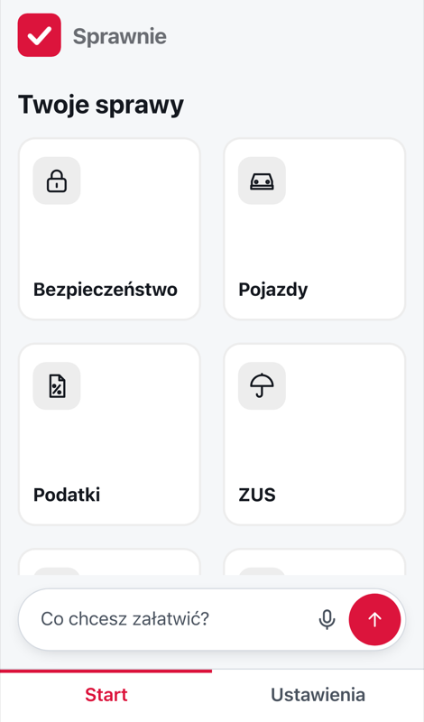
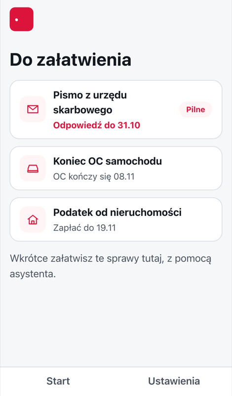
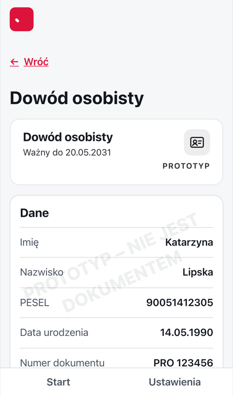
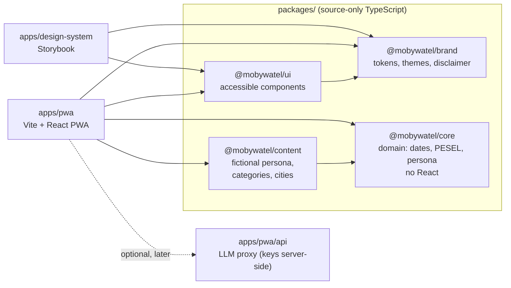

<div align="center">

# Sprawnie

**Sprawy urzędowe prościej.** An unofficial, clickable PWA prototype of a new mObywatel app for the
mobywatel.ai challenge.

Open the link on any phone. No login, no install, works offline after the first visit. Every person and every
number in it is invented.

**[Open the prototype →](https://sprawnie-prototype.vercel.app)**

[](https://github.com/mdopieralski/mobywatel/actions/workflows/ci.yml)


[What's built](#whats-built) · [Quick start](#quick-start) · [How it works](#how-it-works) ·
[Development](#development) · [Testing](#testing) · [Deployment](#deployment-vercel)

<br>


&nbsp;

&nbsp;


<sub>Start · Do załatwienia · a document view (fictional persona, watermarked). iPhone 13 viewport, live site,
28.10.2026.</sub>

</div>

---

## Why

The [mObywatel Challenge](https://mobywatel.ai) asks for a clickable prototype of a mObywatel app that beats
the reference prototype, an AI assistant that handles official matters through conversation. Entries should be
**simpler, more convenient, more accessible, or handle more matters**. The top 10 are presented in the Sejm.
Submissions close **30.11.2026**.

We measured the reference prototype
([`docs/product/reference-analysis.md`](docs/product/reference-analysis.md)) and aim to beat it where it is
weakest:

- **Clear choices as well as chat.** Your matters and deadlines are on the start screen; the assistant is one
  way in, not the only one. Plain Polish, one action per screen.
- **No API key, no network.** The whole demo works offline after the first load; an LLM is an optional extra.
- **More accessible.** WCAG 2.2 AA as the floor, senior mode, follows the phone's text size, zero axe
  violations as the target on every screen.
- **For everyone who lives here.** Eight complete UI languages: `pl` (source), `en`, `uk`, `de`, `cs`, `sk`,
  `lt`, `be`.
- **Not dressed as the state.** Our own artwork, no emblem, no official document designs.

**What this is not.** It is not the mObywatel app, not affiliated with the government, and not a document. It
talks to no registry and stores nothing on a server. Do not type real personal data into it.

## Status

Early prototype, in progress towards the 30.11.2026 deadline. The shell, navigation, documents and reminders
work; the matters themselves and the assistant are next.

### What's built

| Area                        | State    | Notes                                                                                             |
| --------------------------- | -------- | ------------------------------------------------------------------------------------------------- |
| Desktop showcase            | ✅ works | `/` on a desktop: hero plus the app in a phone frame. Phones go straight to `/prototype`          |
| Start screen                | ✅ works | 14 categories, "Co chcesz załatwić?" input                                                        |
| Categories and matter menus | ✅ works | Security, vehicles, ZUS and travel have submenus (23 matters); a city picker for city tickets     |
| Documents                   | ✅ works | ID card, driving licence, Large Family Card, vehicle. Own artwork, watermark, disclaimer          |
| Do załatwienia (reminders)  | ✅ works | Tax office letter, end of car insurance, property tax                                             |
| Settings                    | ✅ works | Language, senior mode, light / dark / system theme, demo reset                                    |
| Offline and install         | ✅ works | Service worker precaches the app; installable as a PWA                                            |
| Matters end to end          | ⏳ next  | Each matter opens a "Wkrótce" (coming soon) screen                                                |
| Assistant                   | ⏳ next  | Scripted, offline scenarios first; optional LLM (Bielik / PLLuM) behind a server-side proxy later |
| Inbox, notifications        | ⏳ later | "Wkrótce" screens                                                                                 |

The demo persona is **Katarzyna Lipska**, a fictional person with a made-up PESEL and document numbers.

---

## Contents

1. [Quick start](#quick-start)
2. [How it works](#how-it-works)
3. [Project structure](#project-structure)
4. [Ground rules](#ground-rules)
5. [Development](#development): stack, how TypeScript runs, environment, scripts, git hooks
6. [Testing](#testing)
7. [Deployment (Vercel)](#deployment-vercel)
8. [Contributing](#contributing)
9. [Limitations and next steps](#limitations-and-next-steps)
10. [License](#license)

---

## Quick start

**You need:** Node 22 (`nvm use` reads `.nvmrc`) and pnpm 10.22.0 (`corepack enable` picks it up from
`packageManager`).

```sh
nvm use
pnpm install
pnpm dev
```

| What                        | Where                                 |
| --------------------------- | ------------------------------------- |
| Showcase (desktop)          | https://mobywatel.local               |
| The app                     | https://mobywatel.local/prototype     |
| Storybook (`@mobywatel/ui`) | https://mobywatel.local/design-system |

`pnpm dev` runs Vite without the service worker. To try offline and install, run the real build:

```sh
pnpm run build && pnpm preview
```

<details>
<summary><b>About <code>mobywatel.local</code> (Portless)</b></summary>

<br>

The dev and preview servers run through [Portless](https://github.com/vercel-labs/portless), which gives them
a stable HTTPS name instead of a port number.

- On first use it asks for `sudo`, to run its proxy on port 443 and trust its local certificate.
- `--lan` is on, so a phone on the same Wi-Fi can open the app too.
- To skip Portless: `PORTLESS=0 pnpm dev` serves plain Vite on `localhost`.
- Storybook alone: `pnpm run dev:design-system`, at http://127.0.0.1:6006.

</details>

Something stuck? Full reset: `pnpm cache:clean && pnpm install`.

---

## How it works

Everything runs in the browser. The app is a static build: no backend, no accounts, no API key.



- **Domain apart from UI.** `@mobywatel/core` is pure TypeScript: matters will be state machines, reminders
  are rules over dates. It never imports React, so it is tested on its own.
- **Content apart from code.** What belongs in which category, the persona, the city list:
  `@mobywatel/content`. UI copy: `apps/pwa/messages/<locale>/*.json`, Polish first, every language complete.
- **Tokens, not literals.** Colours, spacing and type come from `@mobywatel/brand`. A new hex value in `apps/`
  or `packages/ui` is blocked by a hook.
- **Polish URLs.** Paths show in the address bar and in shared links: `/prototype/dokumenty/dowod`,
  `/prototype/do-zalatwienia`, `/prototype/ustawienia`.
- **Offline.** `vite-plugin-pwa` (Workbox) precaches the app shell, fonts and messages. After the first visit,
  the app opens with no network.

Decision records with the reasons: [`docs/decisions/`](docs/decisions/).

---

## Project structure

```
apps/
├── pwa/                     @mobywatel/pwa: the app
│   ├── src/app/             shell, router, layout, error screens
│   ├── src/features/        showcase, home, categories, documents, reminders, settings, travel, …
│   ├── src/platform/        storage, i18n runtime, settings
│   ├── src/pwa/             service worker registration, update and install prompts
│   ├── messages/<locale>/   UI copy: pl (source) + en uk de cs sk lt be
│   ├── e2e/                 Playwright flows (phones and desktops, with axe)
│   └── vercel.json          SPA rewrites, cache and security headers (CSP)
└── design-system/           Storybook for @mobywatel/ui

packages/
├── brand/                   tokens, themes, contrast checks, name, tagline, disclaimer
├── core/                    domain: dates, PESEL, persona model
├── content/                 fictional persona, categories and matters, cities
└── ui/                      accessible React components

docs/
├── product/                 competition brief, reference analysis, brand voice, visual identity
└── decisions/               decision records <topic>-YYYY-MM-DD.md

tools/                       guardrail and harness audits (node --test)
.claude/                     agents, skills and hooks for Claude Code
```

---

## Ground rules

These hold for every change. The guard hooks and `pnpm run audit:guardrails` enforce the first three.

| Rule                        | What it means                                                                                                                             |
| --------------------------- | ----------------------------------------------------------------------------------------------------------------------------------------- |
| **No official marks**       | No state emblem, no mObywatel logo or icons, no official document artwork, no photos from the reference prototype. All artwork is our own |
| **Fictional data only**     | Personas, PESELs, document numbers, plates, addresses and payments are invented. No live registry or government API                       |
| **Visibly unofficial**      | The disclaimer is on the start screen and every document view. Documents carry a "PROTOTYP – nie jest dokumentem" watermark               |
| **No login, works offline** | The jury opens a link on whatever device they have. No accounts, no paywall, no API key prompt                                            |
| **Accessible by default**   | WCAG 2.2 AA, senior mode, screen readers, keyboard, 48 px targets, `prefers-reduced-motion`                                               |
| **Plain Polish**            | Short sentences, no officialese, one action per screen. The assistant confirms before anything is "sent"                                  |

The full version, for people and for Claude Code: [`CLAUDE.md`](CLAUDE.md).

---

## Development

### Stack

|              |                                                                                                                                                                                                                                     |
| ------------ | ----------------------------------------------------------------------------------------------------------------------------------------------------------------------------------------------------------------------------------- |
| **Repo**     | [pnpm](https://pnpm.io/) workspaces, [Turborepo](https://turborepo.com/), Node 22                                                                                                                                                   |
| **App**      | [React 19](https://react.dev/), [Vite 8](https://vite.dev/), [React Router](https://reactrouter.com/), [vite-plugin-pwa](https://vite-pwa-org.netlify.app/) (Workbox)                                                               |
| **Language** | [TypeScript 6.0](https://www.typescriptlang.org/), strict. Packages are source-only `.ts`, no build step                                                                                                                            |
| **i18n**     | [use-intl](https://next-intl.dev/docs/environments/core-library), 8 locales                                                                                                                                                         |
| **UI**       | [Tailwind CSS 4](https://tailwindcss.com/) on `@mobywatel/brand` tokens, [Inter Tight](https://fontsource.org/fonts/inter-tight), [GSAP](https://gsap.com/) for the showcase                                                        |
| **Quality**  | [oxlint](https://oxc.rs/docs/guide/usage/linter), [Prettier](https://prettier.io/), [Commitlint](https://commitlint.js.org/), [Husky](https://typicode.github.io/husky/), [lint-staged](https://github.com/lint-staged/lint-staged) |
| **Tests**    | [Vitest](https://vitest.dev/) + Testing Library, [Playwright](https://playwright.dev/) + [axe](https://github.com/dequelabs/axe-core-npm), `node:test`                                                                              |
| **Hosting**  | [Vercel](https://vercel.com/), static build                                                                                                                                                                                         |

Details and the reasons: [`docs/decisions/stack-2026-10-24.md`](docs/decisions/stack-2026-10-24.md).

### How TypeScript runs

The shared packages have no build step. Each one exports its `src/index.ts` directly, and whoever imports it
compiles it.

|                 | Development and tests                               | Production                                    |
| --------------- | --------------------------------------------------- | --------------------------------------------- |
| **Runs**        | `.ts` files, through Vite/Vitest                    | one bundled JavaScript build in `dist/`       |
| **How**         | `pnpm dev`, `pnpm test`                             | `pnpm run build` (Vite bundles every package) |
| **Type checks** | `pnpm run typecheck` (`tsc --noEmit` per workspace) | the same, in CI                               |

- **Only erasable syntax.** `tsconfig.base.json` sets `erasableSyntaxOnly` and `verbatimModuleSyntax`: no
  `enum`, no namespaces with runtime code, no parameter properties. Imports may use `.ts` paths.
- **Type checking is a separate step.** Vite strips types without checking them. `pnpm run typecheck` checks
  them, and CI runs it.
- **The Vite config is the exception.** Node can't load `.ts` workspace packages from `vite.config.ts`, so it
  imports `@mobywatel/brand` by relative path.
- **TypeScript is pinned to `~6.0`.** typescript-eslint does not support TypeScript 7 yet.

### Environment

None. The app is a static build and needs no `.env`, no API key and no backend. The optional LLM layer, when
it lands, will read its key only in a serverless function under `apps/pwa/api/`; the key never reaches the
browser.

### Scripts

Run from the repo root with `pnpm <name>` (or `pnpm run <name>`).

| Name                    | What it does                                                              |
| ----------------------- | ------------------------------------------------------------------------- |
| `dev`                   | The app and Storybook, at `https://mobywatel.local` (no service worker)   |
| `dev:design-system`     | Storybook alone, at `http://127.0.0.1:6006`                               |
| `build`                 | Build every workspace (the PWA and Storybook)                             |
| `preview`               | Serve the built PWA with its service worker, plus Storybook               |
| `typecheck`             | `tsc` in every workspace                                                  |
| `lint`                  | oxlint in every workspace                                                 |
| `format` / `format:fix` | Prettier: check, or fix                                                   |
| `test`                  | Unit tests in every workspace, then the tool tests                        |
| `test:unit`             | Unit tests only (Vitest)                                                  |
| `test:e2e`              | Playwright flows on phone and desktop viewports, with axe                 |
| `test:tools`            | Tests for the audits and hook rules in `tools/`                           |
| `audit:guardrails`      | No official marks; disclaimer and watermark present                       |
| `audit:harness`         | `.claude/` agents, skills and hooks are consistent                        |
| `ci:quality`            | Everything CI runs, in one command                                        |
| `cache:clean`           | Remove `node_modules`, `.turbo` and `dist`; run `pnpm install` afterwards |

### Git hooks

| Hook         | Runs                                                                                                                           |
| ------------ | ------------------------------------------------------------------------------------------------------------------------------ |
| `commit-msg` | Commitlint: [Conventional Commits](https://www.conventionalcommits.org/) with an area scope, e.g. `feat(ui): add ReminderTile` |
| `pre-commit` | lint-staged: Prettier on staged files                                                                                          |

---

## Testing

```sh
pnpm test            # unit + tool tests, offline, seconds
pnpm run test:e2e    # Playwright against a built app
```

| Layer | Tool                     | Covers                                                                             |
| ----- | ------------------------ | ---------------------------------------------------------------------------------- |
| Unit  | Vitest + Testing Library | tokens and contrast, dates and PESEL, persona and content data, UI components      |
| E2E   | Playwright + axe         | smoke, documents, travel, languages, offline reload, header, boot loader, showcase |
| Tools | `node:test`              | guardrail audit, harness audit, hook rules                                         |

E2E runs on four projects: **iPhone 13** and **Pixel 7** for the app, **desktop Chrome** and **desktop
Safari** (1440 × 900) for the showcase. Most flows also run axe, so an accessibility regression fails the
test.

### CI

[`ci.yml`](.github/workflows/ci.yml) runs `pnpm run ci:quality` on every pull request and every push to
`main`: Prettier, then lint, typecheck, unit tests and build in every workspace, then the tool tests and both
audits. Node comes from `.nvmrc`; install uses `--frozen-lockfile`. A new push to a PR cancels its run in
progress.

---

## Deployment (Vercel)

The app deploys to Vercel as a static build of `apps/pwa` (Vercel project `sprawnie`). Only the production URL
is public: preview deployments sit behind Vercel login, so never hand one to the jury.

| Setting        | Value                                                      |
| -------------- | ---------------------------------------------------------- |
| Root directory | `apps/pwa`                                                 |
| Build command  | `cd ../.. && pnpm turbo run build --filter=@mobywatel/pwa` |
| Output         | `dist`                                                     |
| Production URL | https://sprawnie-prototype.vercel.app                      |

[`apps/pwa/vercel.json`](apps/pwa/vercel.json) adds:

- **SPA rewrites.** Every path without a file extension serves `index.html`, so deep links like
  `/prototype/dokumenty/dowod` work on a cold open.
- **Cache headers.** `sw.js` and the manifest are never cached, so an update reaches users on the next visit.
  Hashed files in `/assets/` are cached for a year.
- **Security headers.** A strict Content-Security-Policy (`'self'` only, no third-party scripts), `nosniff`, a
  referrer policy, and a permissions policy that allows only the microphone (for voice input).

The submission link must work without login and stay up until the results. The final checklist is in the
`competition-submission` skill
([`.claude/skills/competition-submission/`](.claude/skills/competition-submission/)).

---

## Contributing

Branches `feat/<area>`, `fix/<area>`, `docs/…`, `chore/…` from `main`, then a pull request into `main`.
Nothing is pushed to `main` directly, and the maintainer merges.

Most of the work is done with Claude Code and the agents in [`.claude/`](.claude/): each area has an owner
agent (`ui-engineer`, `service-designer`, `accessibility-auditor`, …). The ownership map and the plan → build
→ verify → review flow are in [`CLAUDE.md`](CLAUDE.md) and the `add-feature` skill.

This is a competition entry with a fixed deadline, so outside pull requests are not expected. Issues and ideas
are welcome.

---

## Limitations and next steps

- **Matters are not end to end yet.** Every matter in the menus opens a "Wkrótce" screen. Next: the first
  matters as state machines in `@mobywatel/core`, each with a confirmation step before anything is "sent".
- **No assistant yet.** The "Co chcesz załatwić?" input is there, but it opens a "Wkrótce" screen. Next:
  scripted, offline scenarios in the browser, then an optional LLM (Bielik / PLLuM) behind a server-side
  proxy.
- **One persona.** Only Katarzyna Lipska. More personas (a senior, a newcomer, a parent) would show more
  matters and languages.
- **Nothing is sent anywhere.** By design: no registry, no payments, no server storage. A real app would need
  login, signing and integrations with state systems; the prototype only shows the flow.
- **Accessibility is checked by axe, not by people yet.** VoiceOver and TalkBack walk-throughs and a senior
  user test are still to do.
- **Translations are not reviewed by native speakers.** The 7 non-Polish languages are complete but
  unreviewed.
- **No post-deploy check.** CI proves the build works but does not deploy, and nothing opens the production
  URL afterwards. A smoke test against the live link before submission would close that gap.

---

## License

No licence yet: all rights reserved by the author. The mObywatel name belongs to its owners and is used here
only to name the challenge.
